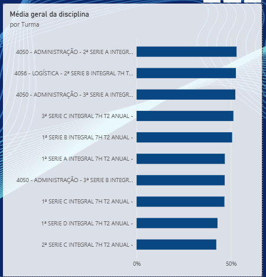
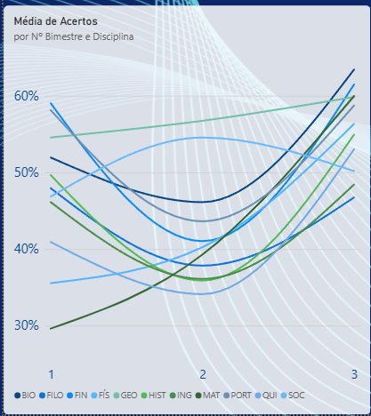
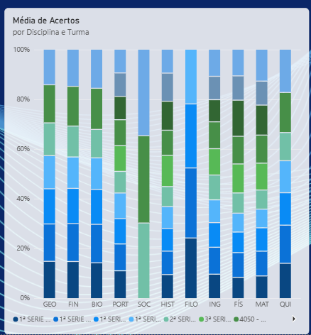

# Dashboard de Desempenho Escolar | Power BI

## 1. Apresentação e Contexto do Problema Analisado
Este projeto apresenta um **Dashboard de Desempenho Escolar** desenvolvido no **Microsoft Power BI**, projetado para monitorar, consolidar e apoiar a gestão pedagógica de indicadores educacionais. O painel centraliza métricas críticas de aprendizagem escolar, permitindo o acompanhamento do progresso dos estudantes ao longo dos bimestres letivos, a identificação de tendências por disciplina e a avaliação do rendimento segmentado por turmas.

---

## 2. Objetivos do Dashboard
* **Monitoramento Contínuo:** Acompanhar a evolução da média de acertos geral e por disciplina ao longo dos bimestres letivos.
* **Acompanhamento de Metas:** Medir o desempenho real da escola em relação às metas de acertos estabelecidas para o período.
* **Gestão por Turma e Disciplina:** Identificar gargalos de aprendizagem e comparar o rendimento acadêmico entre diferentes turmas e componentes curriculares.
* **Visão Temporal:** Comparar a variação percentual bimestral para entender o ritmo de progresso ou estagnação pedagógica.

---

## 3. Ferramentas Utilizadas
* **Microsoft Power BI:** Ferramenta de Business Intelligence utilizada para a modelagem dos dados, criação de medidas de agregação e desenvolvimento da interface visual (dashboards).
* **DAX (Data Analysis Expressions):** Utilizada para o cálculo de KPIs, médias ponderadas, comparações bimestrais e indicadores de variação percentual (quando aplicável no modelo).

---

## 4. Indicadores e KPIs Identificados nas Imagens
O painel exibe cartões e indicadores de desempenho (KPIs) estruturados para uma leitura rápida pela gestão escolar:
* **Média de Acertos (Geral):** Percentual médio geral de acertos alcançado (ex: **56,31%** para o 3º bimestre selecionado).
* **Média de Participação:** Taxa de engajamento/participação dos estudantes nas avaliações (ex: **94,48%**).
* **Variação % Bimestral por Período:** Acompanhamento isolado da variação do desempenho entre os bimestres:
  * 1º Bimestre: `--` (referência base).
  * 2º Bimestre: **-11,22%**.
  * 3º Bimestre: **35,85%**.
* **Média de Acertos e Meta de Acertos por Nº Bimestre:** Indicador que compara o resultado obtido (ex: **56,31%**) com a meta estipulada para o período (ex: **60,00%**, com desvio de **-6,14%**).
* **Variação % Bimestral (Cards Laterais):** Histórico estruturado por linha de bimestre permitindo visualizar o comportamento métrico de cada etapa (1º, 2º e 3º) de forma simultânea.

---

## 5. Gráficos e Visualizações
* **Média de Acertos por Nº Bimestre e Disciplina (Gráfico de Linhas / Tendência):** 
  * *O que responde:* Como cada disciplina (BIO, FILO, FIN, FÍS, GEO, HIST, ING, MAT, PORT, QUI, SOC) evoluiu ao longo dos bimestres 1, 2 e 3. Permite identificar picos de desempenho e quedas acentuadas em matérias específicas.
* **Média de Acertos por Disciplina e Bimestre (Gráfico de Colunas Empilhadas):**
  * *O que responde:* A distribuição proporcional dos resultados por disciplina segmentada pelas cores correspondentes aos bimestres, detalhando a participação de cada ciclo no consolidado da matéria.
* **Média Geral da Disciplina por Turma (Gráfico de Barras Horizontais):**
  * *O que responde:* O ranking e a comparação do desempenho médio geral entre as diferentes turmas da instituição (como turmas de Administração, Logística e Séries Integradas do Ensino Médio).

---

## 6. Filtros e Interatividade Observáveis
O painel disponibiliza filtros superiores interativos que permitem segmentar toda a visualização dos dados em tempo real:
* **Bimestre:** Filtro para selecionar bimestres específicos (ex: 3º) ou visualizar de forma consolidada.
* **Disciplina:** Filtro para isolar componentes curriculares específicos ou visualizar "Todos".
* **Turma:** Filtro para selecionar turmas específicas ou visualizar a escola inteira ("Todos").
* *Filtros cruzados (Cross-filtering):* Os gráficos interagem dinamicamente; ao selecionar uma disciplina ou turma nos visuais, os demais componentes respondem recalculando os KPIs instantaneamente.

---

## 7. Principais Possibilidades de Análise e Apoio à Tomada de Decisão Pedagógica
* **Diagnóstico de Defasagens:** Acompanhar quais disciplinas apresentam quedas de rendimento entre um bimestre e outro para direcionar planos de intervenção pedagógica.
* **Acompanhamento de Metas Institucionais:** Avaliar se a escola está atingindo o patamar projetado (ex: meta de 60%) e identificar o gap restante para ajuste de estratégias didáticas.
* **Comparação entre Turmas:** Identificar quais turmas apresentam melhor desempenho geral e quais demandam suporte direcionado da equipe pedagógica.
* **Análise de Participação:** Monitorar a taxa de adesão dos estudantes às avaliações para garantir a confiabilidade estatística das amostras.

---

## 8. Capturas de Tela do Projeto

| Visão Geral do Dashboard | Evolução por Disciplina e Bimestre |
| :---: | :---: |
| |  |
| *Painel principal com KPIs, filtros e visuais consolidados.* | *Análise temporal de tendências por disciplina.* |

| Distribuição por Disciplina e Turma | Média Geral por Turma |
| :---: | :---: |
|  |  |
| *Detalhamento por componente curricular.* | *Ranking de desempenho por turma.* |

---

## 9. Instruções para Visualizar o Arquivo PBIX no Power BI Desktop
1. Certifique-se de ter o **Microsoft Power BI Desktop** instalado em seu computador.
2. Faça o download do arquivo do projeto (`.pbix`) disponível neste repositório.
3. Dê um duplo clique no arquivo baixado ou abra o Power BI Desktop, vá em **Arquivo > Abrir** e selecione o arquivo do projeto.
4. Caso o relatório utilize uma base de dados local vinculada, configure o caminho da fonte de dados (Excel/CSV) conforme necessário para atualizar os dados do painel.

---

## 10. Estrutura Sugerida de Pastas e Arquivos do Repositório
```text
📦 dashboard-desempenho-escolar
 ┣ 📂 dados              # Arquivos de dados brutos ou tratados (ex: CSV/Excel)
 ┣ 📂 imagens            # Capturas de tela utilizadas na documentação do README
 ┃  ┣ 📜 dashboard-geral.png
 ┃  ┣ 📜 Média de acertos de cada disciplina por bimestre.png
 ┃  ┣ 📜 Média de acertos de cada disciplina por turma.png
 ┃  ┗ 📜 média de acertos gerais da turma.png
 ┣ 📜 dashboard_desempenho.pbix  # Arquivo principal do Power BI
 ┗ 📜 README.md          # Documentação detalhada do projeto
---
##
